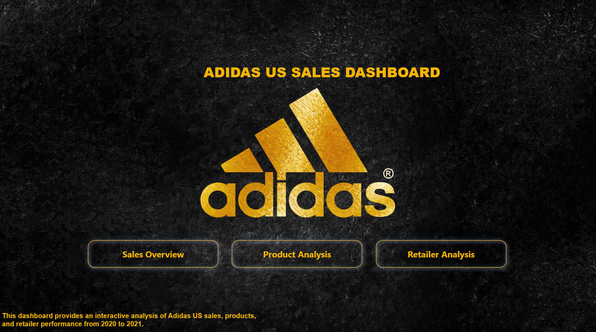
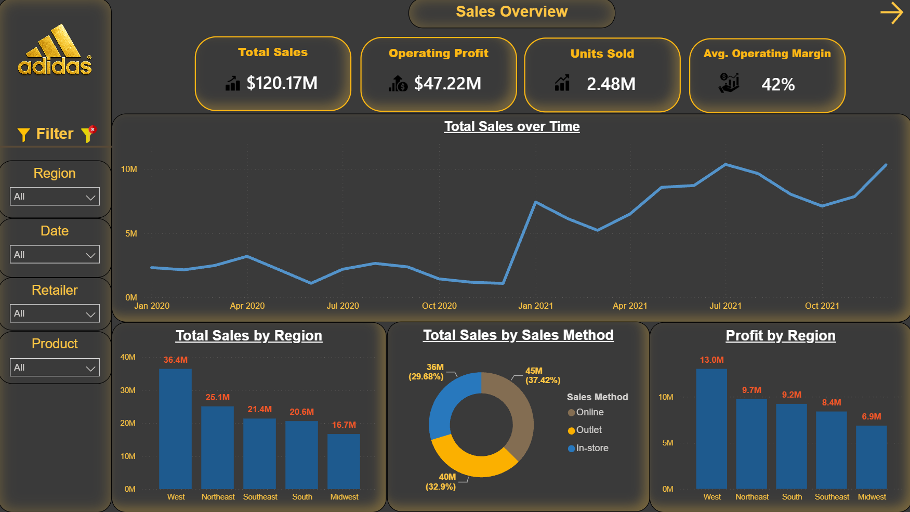
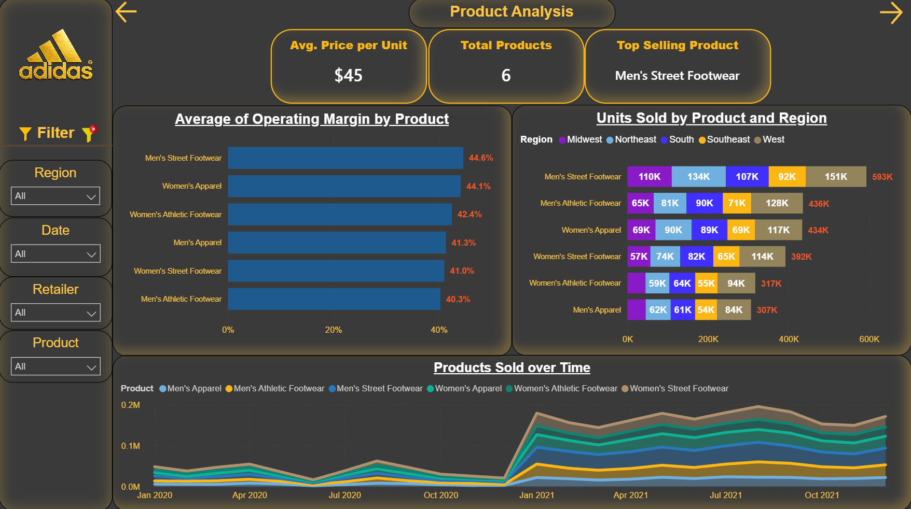
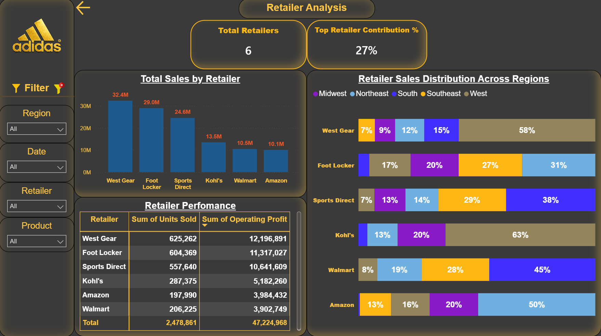

# Adidas US Sales Dashboard | Power BI

> **Independent data analytics portfolio project** focused on exploring US sales performance, product mix and retailer performance across **2020–2021**. This is not an official Adidas dashboard or an indication of affiliation with Adidas.

## Project overview

An interactive Power BI report built around three analysis areas:

- **Sales Overview:** sales, operating profit, units sold, sales channels, geographic distribution and monthly trends.
- **Product Analysis:** product-level margins, units sold by region and product sales trends.
- **Retailer Analysis:** retailer sales rankings, unit volumes, operating profit and regional sales distribution.

The report features slicers for **Region, Date, Retailer and Product**, plus page navigation.

## Dashboard previews

### 1. Sales Overview

### 2. Product Analysis

### 3. Retailer Analysis

## Selected insights

The following numbers are taken from the supplied dashboard screenshots, with slicers displaying **All**:

| Metric | Dashboard value |
| --- | ---: |
| Total sales | **$120.17M** |
| Operating profit | **$47.22M** |
| Units sold | **2.48M** |
| Average operating margin (dashboard measure) | **42%** |
| Distinct product categories shown | **6** |
| Retailers shown | **6** |

- **West** is the largest sales region shown, with **$36.4M** in sales, ahead of **Northeast ($25.1M)**.
- The sales-method mix shows **Online $45M (37.42%)**, **Outlet $40M (32.9%)** and **In-store $36M (29.68%)**. Dollar amounts are rounded on the dashboard.
- **Men's Street Footwear** leads the displayed product-unit ranking with approximately **593K units**.
- **West Gear** is the highest-sales retailer displayed at approximately **$32.4M**. Its operating profit in the retailer table is approximately **$12.20M**.
- The monthly sales chart shows a marked increase from early **2021** relative to 2020. This is a descriptive observation, not a proven causal explanation.

## Tools and files

- **Power BI Desktop** — dashboard authoring and interactive visuals.
- **Excel** — source dataset provided with this portfolio project.
- [Power BI report (`.pbix`)](Adidas%20US%20Sales%20Dashboard.pbix)
- [Source dataset (`.xlsx`)](Adidas%20US%20Sales%20Datasets..xlsx)

> GitHub cannot render a `.pbix` report interactively. Browse the previews above or download the Power BI file and open it in Power BI Desktop. A live interactive link may be added if published to an appropriate public-data workspace.

